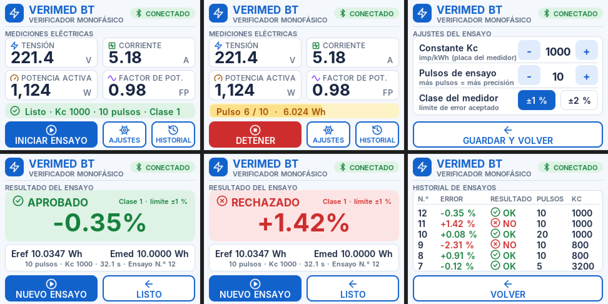

# VeriMed BT

Verificador rápido monofásico portátil para medidores de energía, controlado desde una app móvil vía Bluetooth.

Proyecto de Título — INACAP, asignatura HIPI02.



---

## El problema

Verificar que un medidor de energía esté midiendo dentro de su margen de error permitido requiere hoy equipos que son caros, o que dependen de teclados y pantallas propias que aumentan el costo de fabricación y los puntos de falla. Las empresas distribuidoras eléctricas medianas y pequeñas necesitan equipar a varios técnicos de terreno sin disparar el presupuesto.

**VeriMed BT** propone que la configuración del ensayo, la ejecución y los informes se manejen desde una app móvil, y que el equipo se concentre en la electrónica de medición. El prototipo incorpora además una pantalla táctil de bajo costo integrada en la placa (ESP32-2432S028) para ver el estado y el resultado en terreno.

## Cómo funciona

1. El equipo se conecta al medidor bajo prueba y a una carga: un medidor de referencia mide la energía real que consume la carga, y un sensor óptico cuenta los pulsos del LED del medidor.
2. El ensayo comienza con el primer pulso del medidor y termina al completar N pulsos. El ESP32 compara ambas energías:

   ```
   Eref (Wh) = energía integrada por el medidor de referencia
   Emed (Wh) = N pulsos × 1000 / Kc          (Kc = imp/kWh de la placa del medidor)
   Error (%) = (Emed − Eref) / Eref × 100     →  APROBADO si |Error| ≤ límite de la clase
   ```
3. El resultado y el % de error se envían por Bluetooth de baja energía (BLE) a la app móvil, donde el técnico configura el ensayo, registra el medidor y genera el informe.

```
Red 220 V ── MEDIDOR BAJO PRUEBA ── carga
                  │ LED de pulsos
            sensor óptico ──┐
  medidor de referencia ────┼── VeriMed BT (ESP32) ──BLE──> App móvil
                            │
```

## Stack técnico

- **Microcontrolador:** ESP32 — placa ESP32-2432S028 ("Cheap Yellow Display" 2,8", táctil)
- **Medición de referencia:** PZEM-004T v3.0 (V, I, P, FP, f) en el prototipo actual.
  El diseño original considera el **AD71056**; ver la nota en [docs/HARDWARE.md](docs/HARDWARE.md#nota-sobre-el-ad71056).
- **Conteo de pulsos:** sensor óptico (fotodiodo/fototransistor + LM393) sobre el LED del medidor
- **Comunicación:** Bluetooth Low Energy (BLE) — [protocolo](docs/PROTOCOLO_BLE.md)
- **App:** Flutter (Android / iOS) con Firebase Authentication

## Funciones implementadas

**Equipo** (`firmware/verimed_v2`)
- Mediciones en vivo, ajustes del ensayo (Kc, N pulsos, clase), progreso, resultado e historial guardado en flash.
- Veredicto APROBADO / RECHAZADO en pantalla, LED RGB y pitidos; alarmas de sobretensión, tensión baja y sobrecorriente.
- Bluetooth visible como "VeriMed BT", con encendido/apagado desde la pantalla.
- **Modo simulación** para trabajar sin el hardware de medición.

**App móvil** (`app/`)
- Búsqueda, conexión y reconexión automática por BLE; valores y gráfico de potencia en vivo.
- Ensayo configurado y controlado desde la app, sincronizado con la pantalla del equipo.
- Escaneo del número de serie del medidor (código de barras / QR).
- Foto del medidor con ubicación GPS y dirección del ensayo.
- Historial, exportación CSV e informe PDF con datos del equipo, ubicación, foto y huella SHA-256.

## Estado del proyecto

- [x] ES1 — Ingeniería conceptual: problemática, alternativas de diseño, selección de alternativa
- [x] ES2 — Ingeniería básica y de detalle: alcance, proveedores, métodos constructivos, ensayos
- [ ] ES3 — Implementación (EN PROCESO)
  - [x] Firmware del equipo, Bluetooth y app conectada (modo simulación)
  - [x] Escáner de serie, foto con GPS e informe PDF con trazabilidad
  - [ ] Integración del medidor de referencia y del sensor óptico
- [ ] ES4 — Validación y cierre (EN PROCESO)
  - [ ] Ensayos de repetibilidad y comparación contra medidor patrón

## Estructura del repositorio

```
VeriMedINACAP/
├── docs/           Informe de ingeniería, guías de hardware, protocolo BLE y configuración
├── firmware/       Código del ESP32 (firmware principal, diagnóstico, calibración táctil, User_Setup.h)
├── app/            Código de la app móvil (Flutter)
├── hardware/       Esquemáticos y diagramas del circuito (por agregar)
└── media/          Fotos y video del prototipo (por agregar)
```

## Puesta en marcha

- **Equipo:** Arduino IDE 2.x, placa *ESP32 Dev Module*, librerías `TFT_eSPI` y `XPT2046_Touchscreen`
  (con hardware real también `PZEM-004T-v30`). Copiar `firmware/tft_espi_config/User_Setup.h` en la librería TFT_eSPI,
  elegir **Partition Scheme → Huge APP** y subir `firmware/verimed_v2`.
- **App:** copiar en `app/` el resto del proyecto Flutter y los archivos de Firebase (no se suben al repositorio),
  luego `flutter pub get` y `flutter run`. Detalles en [docs/CONFIGURACION_APP.md](docs/CONFIGURACION_APP.md).
- **Hardware:** qué comprar y cómo conectarlo en [docs/HARDWARE.md](docs/HARDWARE.md).

> El montaje de ensayo trabaja con **220 V**: usar fusible, caja cerrada y supervisión del laboratorio.

## Documentación

- [PreeInforme de Proyecto de Título (FORMATIVO)](docs/Informe_Proyecto_de_Titulo%20(1).docx)
- [Evaluación n°1 Proyecto de Título (SUMATIVA)]
- [Presentación técnica](docs/VeriMed_BT_Presentacion.pdf)
- [Presentación comercial](docs/VeriMed_BT_Comercializacion.pdf)
- [Hardware: compras y conexiones](docs/HARDWARE.md)
- [Protocolo Bluetooth LE](docs/PROTOCOLO_BLE.md)
- [Configuración de la app](docs/CONFIGURACION_APP.md)

## Limitaciones

- El PZEM-004T tiene una exactitud aproximada de ±0,5 %: sirve para verificar medidores clase 2 y, con margen, clase 1, pero no reemplaza un patrón certificado.
- Los resultados en modo simulación son ilustrativos y así se indica en la app y en el informe.

## Equipo

- Felipe Martínez
- Tomás Quezada
- Docente guía: Carlos Castillo (HIPI02)

## Licencia

Este proyecto está bajo la licencia MIT — ver el archivo [LICENSE](LICENSE) para más detalles.
