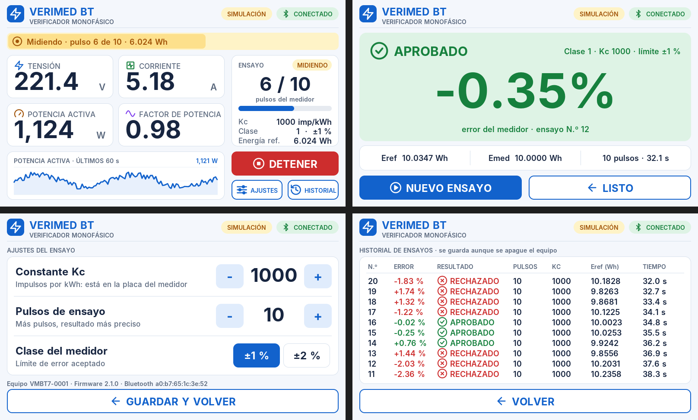

# Pantalla de 7" — VIEWE UEDX80480070E-WB-A V1.1

Versión del equipo con pantalla táctil IPS de 7" (800×480). Usa el **mismo protocolo Bluetooth** que el firmware del CYD, así que la app se conecta sin cambios.

| Característica | Valor |
|---|---|
| Microcontrolador | ESP32-S3-N16R8 (16 MB flash, 8 MB PSRAM octal) |
| Pantalla | IPS 7" 800×480, interfaz RGB de 16 bits (EK9716BD3, compatible ST7262) |
| Táctil | Capacitivo GT911 por I2C (SDA IO19, SCL IO20) |
| Retroiluminación | PWM en IO2 |
| Librería gráfica | LovyanGFX |

## Firmware

| Carpeta | Uso |
|---|---|
| `firmware/verimed7_prueba` | Prueba de pantalla, colores, PSRAM y táctil |
| `firmware/verimed7` | Firmware completo del verificador |

### Arduino IDE → Herramientas

| Opción | Valor |
|---|---|
| Placa | **ESP32S3 Dev Module** |
| PSRAM | **OPI PSRAM** (sin esto la pantalla queda negra) |
| Flash Mode | QIO 80MHz |
| Flash Size | 16MB (128Mb) |
| Partition Scheme | 16M Flash (3MB APP/9.9MB FATFS) |
| USB CDC On Boot | Disabled si se programa por el puerto **UART**; Enabled si es por el puerto USB |

Al cambiar de placa estas opciones se reinician: revisarlas cada vez que se alterna entre el CYD y la pantalla de 7".

Librerías: `LovyanGFX` (lovyan03) y, con hardware real, `PZEM-004T-v30`.

## Decisiones técnicas

**Polaridades del panel.** La configuración oficial de Espressif usa flanco de bajada del reloj de píxeles (`pclk_active_neg = 1`). En LovyanGFX ese mismo registro (`lcd_ck_out_edge`) lo controla `pclk_idle_high`, por eso `LGFX_VeriMed7.h` usa `pclk_idle_high = 1` y polaridades HSYNC/VSYNC en 1. Con otros valores la pantalla queda negra con una línea que parpadea.

**Estabilidad de la imagen.** La pantalla RGB lee su imagen continuamente desde la PSRAM; si el programa usa mucho la PSRAM o la flash, la imagen se corre hacia un lado. Por eso:
- Se dibuja en una franja de 800×40 en la **RAM interna** y cada zona se escribe una sola vez en la pantalla.
- Cada 0,5 s solo se repintan los números, la curva del gráfico y los datos del ensayo.
- Reloj de píxeles en 14 MHz (`VERIMED7_PCLK_HZ`; se puede bajar a 12 MHz).
- Las escrituras en la flash (historial, configuración) se hacen en un solo bloque, solo si algo cambió, y con la luz de la pantalla baja durante unos milisegundos para ocultar la pérdida de sincronismo.

**Pila del programa.** LovyanGFX copia cada carácter en la pila; el "%" de la fuente de 112 px ocupa ~9,7 KB y la pila por defecto del `loop()` es de 8 KB. El firmware la aumenta a 32 KB con `SET_LOOP_TASK_STACK_SIZE`.

## Pines para el PZEM y el sensor óptico

La pantalla ocupa casi todos los pines. Quedan libres los de la **ranura microSD** (sin tarjeta insertada), accesibles con un adaptador "microSD a pines" (*microSD sniffer / breakout*):

| Pin | Conexión | Constante en `verimed7.ino` |
|---|---|---|
| IO12 | `DO` del sensor óptico | `PIN_PULSOS` |
| IO13 | RX del ESP32 ← TX del PZEM | `PZEM_RX` |
| IO11 | TX del ESP32 → RX del PZEM | `PZEM_TX` |
| GND / 3.3V | Alimentación del sensor y del lado TTL del PZEM | — |

El conector UART de la placa (IO43/IO44) es el mismo puerto que se usa para programar, por eso no se usa para el PZEM.

Referencia de pines: [repositorio oficial VIEWESMART](https://github.com/VIEWESMART/UEDX80480070ESP32-7inch-Touch-Display) y [ESP32_Display_Panel](https://github.com/esp-arduino-libs/ESP32_Display_Panel/blob/master/docs/board/board_viewe.md).
